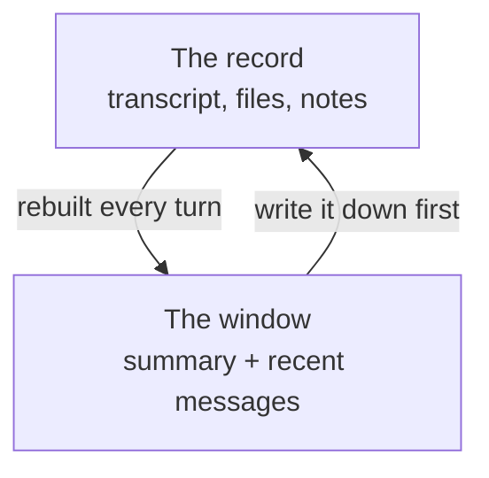

When a long agent session runs out of room, it writes itself a note and forgets everything else.

The note is usually good. Steven Poitras [measured one](https://agenticthinking.ai/blog/what-compaction-actually-destroys). A session hit its limit at about 650,000 tokens and came back as a summary of about 20,000. The summary was right about the shape of the work. The migration was underway, the loader was done, three call sites remained.

But it had lost 96 of the 101 file paths the session had touched, 43 of the 44 URLs, and all 31 of the record ids it had cited. Five of those ids came back cut off after eight or nine characters, which is worse than losing them. They looked like references. They pointed at nothing.

So the agent knew three call sites remained. It no longer knew which three.

This matters more than it sounds. [Microsoft looked at 13.5 million Copilot agent sessions](https://www.microsoft.com/en-us/research/publication/benchmarking-long-horizon-agent-context-compaction-with-compactionbench/). Only 7.8% ever hit compaction, but those sessions used 44.2% of all the tokens. The sessions that run out of room are the ones doing the most work.

The usual response is to build a better summarizer. A stronger model, a better prompt, a bigger window. I think that's the wrong layer. The summary didn't fail because it was bad. It failed because it was a summary.

A summary keeps what happened. An agent about to act needs something else: the path, the id, the exact name of the flag. Prose survives summarizing. Pointers don't. Poitras found that decisions written in ordinary sentences mostly survived, about three in four, and that the citations he planted didn't survive once.

You can't prompt your way out of that, because it's a property of the format.

The way out is to stop treating the conversation as the only copy of the work.

Think about what a CPU does with its cache. It throws things out constantly, and nobody worries, because everything it throws out is still in memory. A miss isn't a failure. It's a slower read. Agents are in the opposite position. The context window is the only copy, so every eviction is a loss.

Fix that and compaction stops being scary. The context window is a cache. The work lives somewhere else.

_The window is a view of the work. It is not the work._

That's roughly how I built Thirdpen. The full conversation is never thrown away, and the person always sees all of it. Only what the agent reads gets shortened. After a turn that read more than about 100,000 tokens, the older part is summarized, the most recent 24,000 or so tokens are kept word for word, and each new summary folds in the last one. The summarizer is told to quote exact wording for names, numbers and dates, and to list files by path.

That helps. But I don't trust it with the real work. The real work lives in a workspace of files that the agent reads and writes with tools, instead of being handed a transcript.

Routines, the jobs that run on a schedule, get one more file: `routine/notes.md`. Each run reads it first and rewrites it last. It holds what the next run needs: where this one stopped, what's still open, what the person asked for. The prompt says the file should be short and current, and that it is not a log. A run can lose its whole conversation and pick up from that one page.

The rule underneath is to write things down before they fall out, not after. A summary is made after the fact, so whatever it drops is gone. A note written while the work happens costs one line.

Poitras tested the other way too. He saved the summary durably, right after compaction. It never remembered more than the summary held. Capturing something after it has been squeezed just stores the loss.

So keep the pointers in a file as you go: paths, ids, urls, ticket numbers. Let the summary carry the intent. Then, after a boundary, read the file, not the summary.

Rules are the same problem, only worse. [One study](https://arxiv.org/abs/2608.22752) measured Claude Code's default compaction and found it kept 53% of safety rules after one round and 10% after five. A rule that only works in its exact wording can't survive being paraphrased. So put rules where compaction can't reach them, and put them back from the source on every turn. A rule that is usually present isn't a rule.

Actions need the same care. In [AgentSpec](/blog/why-ai-authored-workflows-became-a-compiler-problem), the model used to be the scheduler, and the process could die between "I sent the email" and "I recorded that I sent the email." We fixed that with a journal, written before and after every side effect. An agent turn is just a smaller workflow, with the same hole in it.

How do you know it works? Take a real task, and halfway through, throw away the conversation. Keep the disk. Let the agent resume, and see whether it finishes and whether it does anything twice. Try it a quarter of the way through, then halfway, then three quarters.

If it finishes every time, your state is somewhere safe. If it falls off a cliff, you don't have a model problem. You have a missing note.

The cheapest check is also the dullest. List the paths and ids that were live before the cut, and see how many are still there after. You don't need a judge model for that. A string is either there or it isn't.

Won't a bigger window fix all this? Poitras also recorded a compaction at about 998,000 tokens. Whatever window that session had, it was at least that big. A bigger window moves the boundary. It doesn't remove it.

And bigger isn't better. [Chroma tested 18 models](https://research.trychroma.com/context-rot) and found that a focused prompt of about 300 tokens beat a full one of about 113,000 on the same question. A longer context is a bigger cache with worse hit rates.

None of this is really about memory. It's about not asking a forgetful thing to be the database. The model can be brilliant and forgetful, and the system has to be the part that remembers.

A reliable agent isn't one with a perfect memory. It's one that can lose its mind without losing its place.
