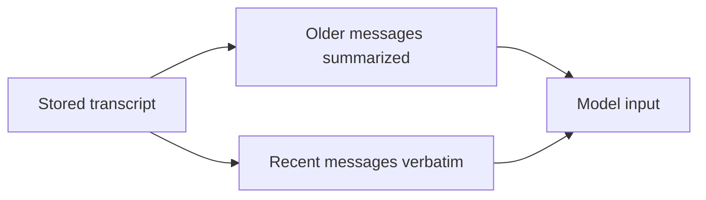
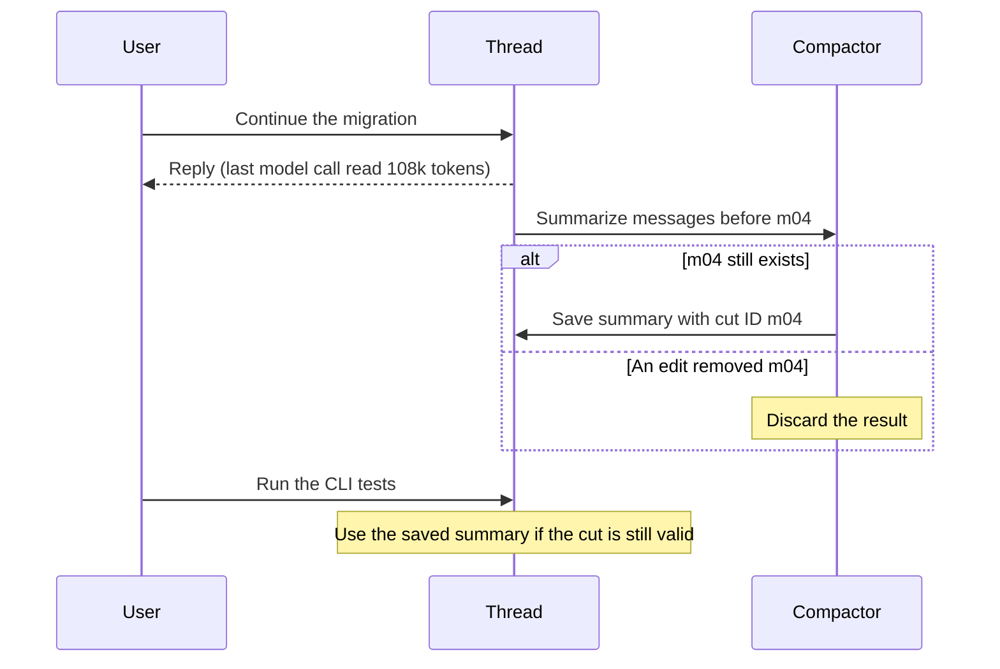

After compaction, an agent can know it has three call sites left to migrate and still have to search the repo to find them. Steven Poitras showed how easily this happens. He compacted a working session and the summary kept [five of its 101 file paths](https://agenticthinking.ai/blog/what-compaction-actually-destroys/). If the agent had written the remaining paths to a file as it worked, it could open the file and carry on.

In Thirdpen the agent has a workspace it can read and write all session long. The files are still there when the model gets the shorter conversation.

## What the model sees

Compaction doesn't touch what you see. You can scroll the full conversation in Thirdpen after it's compacted. What changes is the next model request: a summary of the older messages, plus about 24,000 tokens of recent messages kept word for word.



To choose the cut, we count back from the end of the transcript until we hit a user message inside the budget. The latest user message always stays, even if its turn is bigger than the budget. The summary is attached to the first retained user message, so the model starts on a turn boundary. On the next compaction, the summarizer gets the previous summary plus the messages that have since fallen behind the cut.

I ran a five-message migration through Thirdpen's window planner with a small token budget and a fixed summary. The cut lands at `m04`, and the summary becomes the first text part of that user message.

```text
Stored transcript
  m01  m02  m03  m04  m05

Model input (cutMessageId: m04)
  m04 user
    Summary:
      Loader ready.
      Three callers remain.
    Keep CLI output unchanged.
  m05 assistant
    I’ll keep the formatter.

After replacing m04 with m06
  summaryStale: true
  window: null
```

We store the ID of the first retained message. If an edit or retry removes it, the summary may describe a conversation the user has since changed. Scheduled routines also store the ID of the latest run's starting message, so one run's summary expires when the next run starts.

```ts
export function summaryCutIndex(messages, summary, runIndex = latestRunIndex(messages)) {
	const floor = runIndex >= 0 ? messages[runIndex]!.id : null;
	if (summary.floorMessageId !== floor) return -1;

	const index = messages.findIndex((message) => message.id === summary.cutMessageId);
	if (index <= runIndex || messages[index]?.role !== 'user') return -1;

	return index;
}
```

Say the user edits `m04` and the replacement comes back as `m06`. `findIndex` returns `-1`, we drop the summary, and the input is built from the current transcript. We run the same `m04` check before saving a new summary, because the edit can land while the summarizer is still working.

There's a second check when we build the request. Model messages carry no transcript IDs, and one assistant message with a tool result can become several model messages. So we count user messages to find the cut in the request, then check that its opening text matches. If it doesn't, we send the request without the window.

## Compaction runs after the reply

If the last model call in a turn read at least 100,000 input tokens, or the turn ended on a context overflow error, we start compaction in the background with `waitUntil`. The turn is already over by then. Only one compaction runs per thread at a time. If it fails, the next turn that crosses the threshold tries again.



The threshold leaves room for tool output. One turn can add tens of thousands of tokens before we get another chance to compact. Running in the background also keeps summarization off the reply path. Until a new summary lands, ordinary turns keep appending to the same prefix, and the provider can reuse its cache. Compaction changes that prefix, so the cache has to warm up again. Microsoft covers the cost of doing this in the foreground in its [CompactionBench writeup](https://www.microsoft.com/en-us/research/publication/benchmarking-long-horizon-agent-context-compaction-with-compactionbench/).

## What goes in the workspace

I ask the summarizer to keep the goal, the decisions, the files produced and the open items, and to copy names and paths exactly. Once the agent has the three paths and knows to keep the CLI output, it can write both into `migration.md`.

```md
# Move callers from `getAccount` to `loadAccount`

Loader is ready. Keep the CLI output unchanged.

- [ ] `src/api/accounts.ts` (`getAccountHandler`)
- [ ] `src/jobs/reconcile.ts` (`reconcileAccount`)
- [ ] `src/cli/accounts.ts` (`showAccount`)
```

When it finishes `getAccountHandler`, it checks off the line. A later turn opens the file and goes straight to `reconcileAccount`, even if the summary only said "the migration is in progress." Permissions and safety rules aren't in any of this. They come from the system prompt on every turn.

Scheduled routines are where this matters most. Each run reads `routine/notes.md` at the start and updates it at the end. Tell a routine to skip newsletters and that preference goes in the notes, so tomorrow's run applies it. The notes are also where a run leaves anything unfinished for the next one.

The model still gets a small digest of the last three runs, built straight from the transcript: a short excerpt of each final reply and up to four user follow-ups per run. That way the agent sees a correction like "Skip newsletters from now on" without spending context on the opening "On it."

## What if the agent retries a send?

A file can say what the agent meant to do. Whether an email actually went out is something the runtime has to track. In AgentSpec, we journal actions and check an idempotency ledger before making another call. Say a retry comes in for `run_42:send_digest` and the ledger already holds a successful result with provider message ID `email_918`. The adapter returns that result and skips the send. If the provider accepted a send just before the process died, recovery depends on whether we can confirm or safely retry that request. I wrote about the journal and ledger in [Why AI-authored workflows became a compiler problem](/blog/why-ai-authored-workflows-became-a-compiler-problem).

## Try resuming without the chat

Pick a task the agent already knows how to do. Halfway through, give it a fresh conversation with the original goal, the same workspace and the same action records. See whether it finishes, whether it sends anything twice, and how much it redoes. Then try it a quarter of the way through, and three quarters. For the migration, I'd check whether it finds the remaining call sites from what it saved, or searches the repo from scratch.
