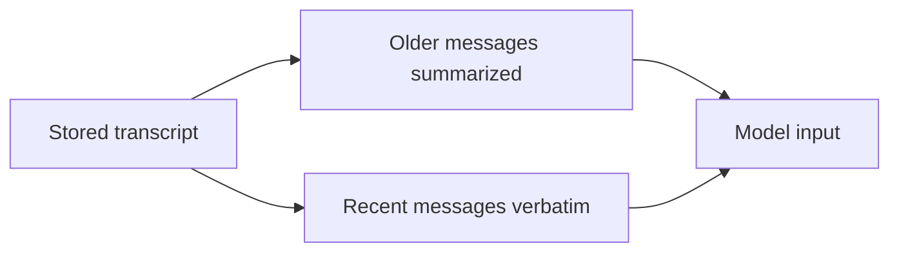
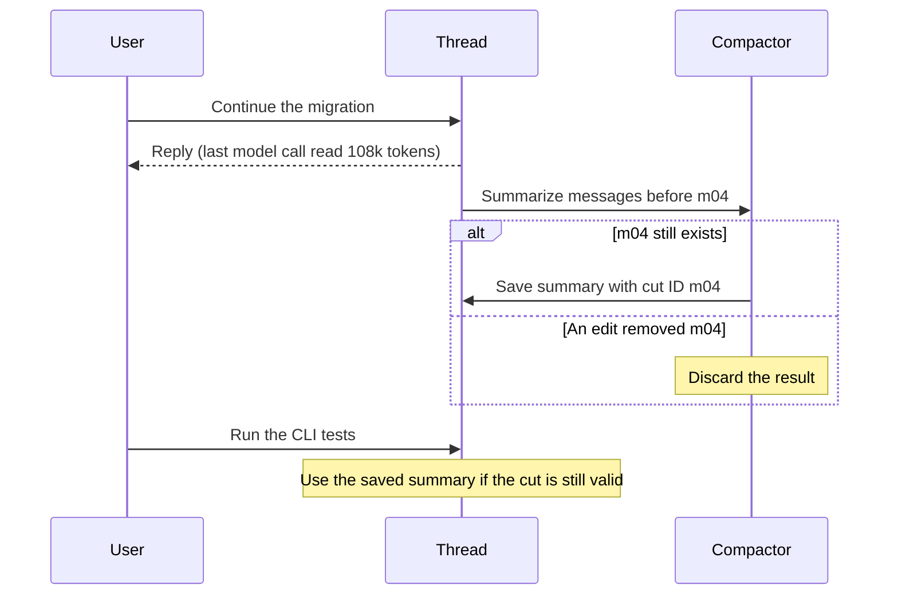

An agent can come out of compaction knowing it has three call sites left to migrate and still have to search the repo to find them. Steven Poitras saw how easily that can happen when he compacted a working session and the summary kept [five of its 101 file paths](https://agenticthinking.ai/blog/what-compaction-actually-destroys/). If the agent writes the remaining paths to a file while it’s working, it can open that file and get on with the migration.

In Thirdpen, the agent has a workspace it can read and write throughout the session. The files are still there when the model gets a shorter version of the conversation.

## What we send to the model

You can scroll back through the full conversation in Thirdpen after it’s been compacted. The change is in the next model request. We send a summary of the older messages and keep about 24,000 tokens of recent messages verbatim.



To pick the cut, we count backward from the end of the transcript and look for a user message within that budget. The latest user message stays even if its turn is bigger than the budget. We attach the summary to the first retained user message so the model starts at a turn boundary. When we compact again, we give the summarizer the previous summary and the messages that have since fallen before the cut.

I ran a five-message migration through Thirdpen’s window planner with a small token budget and a fixed summary. The cut lands at `m04`. The summary goes into that user message as its first text part.

```text
Stored transcript
  m01  m02  m03  m04  m05

Model input (cutMessageId: m04)
  m04 user
    Summary:
      Loader ready.
      Three callers remain.
    Keep CLI output unchanged.
  m05 assistant
    I’ll keep the formatter.

After replacing m04 with m06
  summaryStale: true
  window: null
```

We store the ID of the first retained message. If an edit or retry removes it, the summary may describe a conversation the user has since changed. For scheduled routines, we also store the ID of the latest run’s starting message, so a summary from one run expires when the next starts.

```ts
export function summaryCutIndex(messages, summary, runIndex = latestRunIndex(messages)) {
	const floor = runIndex >= 0 ? messages[runIndex]!.id : null;
	if (summary.floorMessageId !== floor) return -1;

	const index = messages.findIndex((message) => message.id === summary.cutMessageId);
	if (index <= runIndex || messages[index]?.role !== 'user') return -1;

	return index;
}
```

If the user edits `m04` and the replacement comes back as `m06`, `findIndex` returns `-1`. We drop the summary and build the model input from the current transcript. We also check for `m04` before saving a new summary, since the same edit can happen while the summarizer is running.

There’s another check when we build the request. The model messages have no transcript IDs, and one assistant message with a tool result can expand into several model messages. We count the user messages to locate the cut in the request, then check that its opening text matches. If it doesn’t, we send the request without applying the window.

## Compaction runs after the reply

When the last model call in a turn reads at least 100,000 input tokens, or the turn ends with a context overflow error, we start compaction in the background with `waitUntil`. The turn has already ended by then. Only one compaction runs per thread at a time. If it fails, the next turn that crosses the threshold can try again.



The threshold leaves room for tool output. A single turn can add tens of thousands of tokens before we get another chance to compact. Doing the work in the background also takes summarization off the reply path. Until a new summary lands, ordinary turns can keep appending to the same prefix, which the provider can reuse. Compaction changes that prefix, so the cache has to warm up again. Microsoft covers the cost of doing this in the foreground in its [CompactionBench writeup](https://www.microsoft.com/en-us/research/publication/benchmarking-long-horizon-agent-context-compaction-with-compactionbench/).

## What I put in the workspace

I ask the summarizer to keep the goal, decisions, files produced, and open items, and to copy names and paths exactly. Once the agent has the three paths and knows to preserve the CLI output, it can put both in `migration.md`.

```md
# Move callers from `getAccount` to `loadAccount`

Loader is ready. Keep the CLI output unchanged.

- [ ] `src/api/accounts.ts` (`getAccountHandler`)
- [ ] `src/jobs/reconcile.ts` (`reconcileAccount`)
- [ ] `src/cli/accounts.ts` (`showAccount`)
```

After it updates `getAccountHandler`, it can check off that line. A later turn can open the file and go straight to `reconcileAccount`, even if all it got from the summary was “the migration is in progress.” Permissions and safety rules come from the system prompt on every turn.

Scheduled routines are where this matters most in Thirdpen. Each run reads `routine/notes.md` at the start and updates it at the end. If you tell a routine to skip newsletters, that preference belongs in the notes so tomorrow’s run can apply it. The notes also give the next run a place to pick up anything the last run left open.

We still give the model a small digest of the last three runs. We build it directly from the transcript, keeping a short excerpt of each final reply and up to four user follow-ups per run. That lets the agent see a correction like “Skip newsletters from now on” without spending context on the opening “On it.”

## What happens if the agent retries a send?

A file can tell the agent what it meant to do. Whether an email actually went out is something the runtime has to track. In AgentSpec, we journal actions and check an idempotency ledger before making another call. Suppose a retry comes in for `run_42:send_digest` and the ledger already has a successful result with provider message ID `email_918`. The adapter returns that result and skips the send. If the provider accepted a send just before the process died, recovery still depends on whether we can confirm or safely retry that request. I wrote about the journal and ledger in [Why AI-authored workflows became a compiler problem](/blog/why-ai-authored-workflows-became-a-compiler-problem).

## Try resuming without the chat

Take a task the agent already knows how to do. Halfway through, give it a fresh conversation with the original goal and the same workspace and action records. See if it can finish, whether it sends anything twice, and how much work it has to redo. Try the same thing a quarter and three quarters of the way through. For the migration, I’d check whether it can find the remaining call sites from what it saved or has to search the repo all over again.
