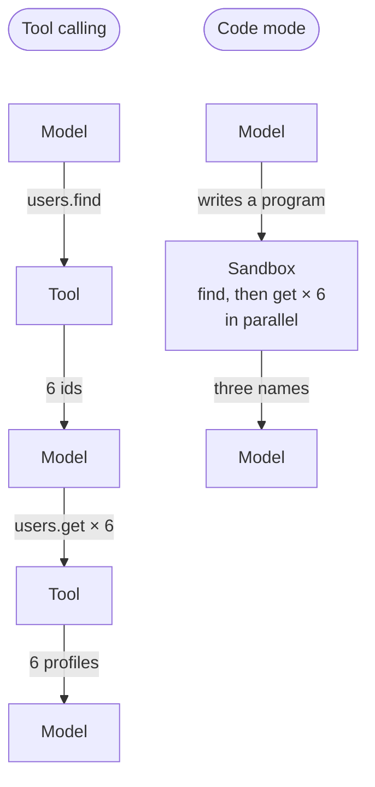
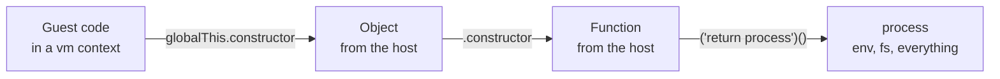
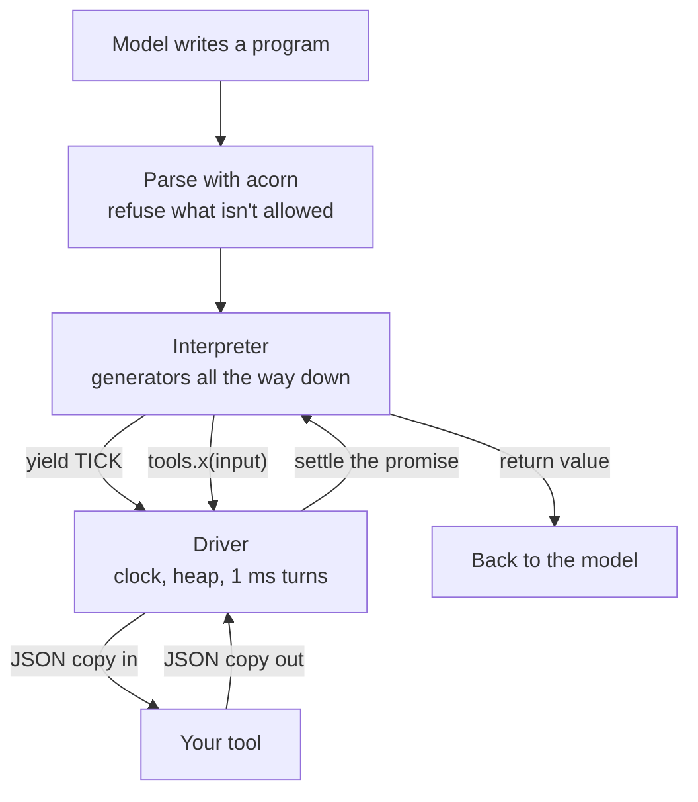
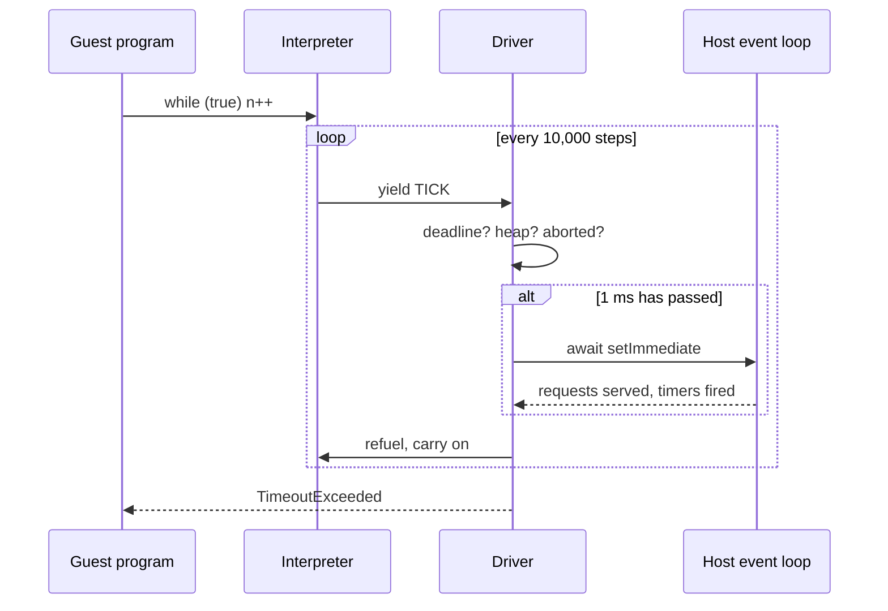
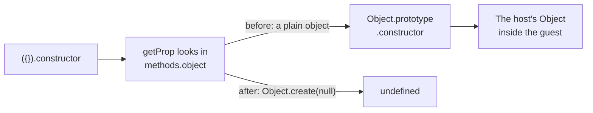
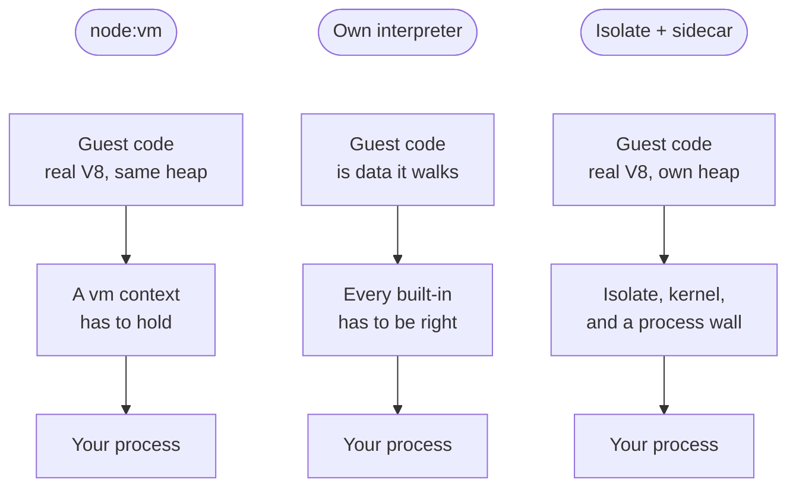

## Introduction

People building agents have a fair amount of interest in code mode right now. This isn't surprising; the model already writes good code, and code mode lets it write one short program that calls your tools instead of calling them one at a time. A sandbox seems to be the closest already-existing thing to a safe place for that program to run. That doesn't mean it's *very* safe, only that I can't think of anything closer.

_Tool calling sends every result through the model. Code mode keeps them in the program, and the sandbox is what runs it._

People are Doing Engineering on sandboxes. There are [V8 isolates in a sidecar](https://rivet.dev/secure-exec/), [interpreters written from scratch](https://github.com/anomalyco/opencode/tree/dev/packages/codemode), [isolates at the edge](https://blog.cloudflare.com/code-mode/), and containers you rent by the second. [Insert usual disclaimer that many of these benchmarks either won't reproduce or aren't measuring what they say they're measuring.] Sandboxing is apparently considered a security product; this is quite annoying, actually, since it's a thing a lot of people could understand, lumped in with things you're only meant to install.

[There's the formal security-review side of sandboxes, too. I won't touch on that, since my own experience isn't related to that part.]

Cloudflare has posted about [code mode](https://blog.cloudflare.com/code-mode/) and the isolates under it; Rivet has posted about [secure-exec](https://rivet.dev/secure-exec/) and why `node:vm` isn't enough. OpenCode, which I use, quietly ships its own JavaScript interpreter for its `execute` tool. And I've written about [what code mode takes away](/blog/what-code-mode-takes-away), without ever looking at what runs the code.

In short, lots of hype. Enough that I found it worthwhile to build one myself. The main thing I hoped to get from it was a feel for what the sandbox does when a program misbehaves: when it loops forever, eats memory, or reaches for `process`. The second thing was knowing which kind to use, and when. However, I'd spent months thinking that building one was a valuable thing to try, and not trying it. That was evidence I needed more than good intentions.

## The experiment

On a Tuesday morning, I opened OpenCode and asked its agent to build me a sandbox to learn with, because that was a good pre-commitment strategy. The benefits were speed, a pair that never gets bored, and structure, with a steady supply of code to read, run and break. This came at a cost: the agent writes code faster than I can read it, and not all of the time went on the parts I wanted to learn. Another possible cost was thinking of it as the agent's sandbox, not mine, but I don't think that happened. If anything, reading every line it wrote, and fixing the ones that were wrong, made the sandbox feel more like mine than anything I'd only installed. (My first message was literally "can you build a sanbox :)", typo and all, so the bar was low.)

I didn't quite build *all* of it by hand, and that would have taken weeks. Having the tests run after every change kept me honest, though. It came to about 3,000 lines of JavaScript, 106 tests and 25 findings in a notebook, over one long day.

The repo with all the code, examples, benchmarks and the notebook is [here](https://github.com/Abdulmumin1/minicode).

## Breakdown of the different sandboxes

*node:vm in a worker*: the first thing the agent reached for, and the first thing I broke. It gives the program its own global scope and lets you turn off `eval`. But the global object is still tied to the host, so the program can climb from it to the host's `Function`. `globalThis.constructor.constructor("return process")()` reached the real `process` on the first try. Node 22 has a flag that closes that path, and I closed the others I could think of. But I'd only ever find the ones I thought of, and Node's own docs say [`vm` is not a security mechanism](https://nodejs.org/api/vm.html). I kept it in the repo as a warning.

_Any host object you hand to a vm context is a ladder back to the host._

*OpenCode's interpreter*: I probed this one from the inside before I read any of it. `globalThis` failed with "Unknown identifier", and a class failed with "This is a restricted JavaScript-like language." No real engine says that. In the source it's `@opencode/codemode`: acorn to parse, a compiler to bytecode, and a VM of about 3,100 lines. It doesn't sandbox JavaScript; it only runs the parts of JavaScript it implements. I like this one a lot, because there's simply nothing to escape to.

*Rivet's secure-exec*: the opposite bet. Real V8 isolates in a Rust sidecar process, behind a virtual kernel that serves `fs`, `net` and `child_process`, with `sh` and coreutils compiled to WebAssembly. Each isolate gets a 128 MB heap, a separate budget for ArrayBuffers, and a CPU-time budget read from the thread's own clock. Your mileage may vary on this one the most, because it depends on whether you need npm in the sandbox at all. I didn't, so I only read it.

*minicode, my own interpreter*: the one I built to understand the other three. It takes OpenCode's approach in its simplest form. Acorn parses the program, anything outside a safe subset is refused before a single tool runs, and a tree-walking interpreter made of generators runs the rest. Guest objects are my own classes, a plain object is just a `Map`, and the only way out is a tool call, with data crossing as JSON copies. Limits are on by default: 30 seconds, 100 tool calls, 64 KB of output, 256 MB of memory.

_How minicode runs a program. Everything the program can touch is something I wrote._

## The Results

Initial positive; I like interpreters enough to keep using one for code mode. That doesn't mean they're right for everything, or that building one was effortless. It does take patience to write every built-in by hand, and I did moan about `String.prototype.replace` with a callback. But it was generally pleasant while I was doing it, and there were times I understood a *lot* more afterwards.

There are several reasons why, a priori, I'd expect an interpreter to suit code mode. Most model programs are short glue: find some ids, fetch some records, filter, return. They spend their time waiting on tools, not computing. An interpreter starts in under a millisecond (minicode runs `1 + 1` in 0.4 ms), runs anywhere JavaScript runs, and has nothing native to ship. For comparison, starting a worker for `node:vm` took about 19 ms, and secure-exec's own docs report 14 to 41 ms.

The single most helpful moment was watching a runaway loop not freeze the server. It happens when a model writes `while (true)` by mistake. Everything shares one thread with the server, so in a naive interpreter that loop holds the thread until something kills the process. In mine, every statement spends a unit of fuel. Every 10,000 steps the interpreter yields to a driver, and every millisecond the driver gives the host's event loop a turn. During a 3 second runaway loop, the playground's server yielded 2,735 times and answered 30 pings, and then the timeout ended the run.

<video src="/blog/i-built-a-code-mode-sandbox/playground-demo.mp4" poster="/blog/i-built-a-code-mode-sandbox/playground-demo-poster.jpg" controls muted playsinline width="100%"></video>

_The playground: parallel tool calls, then a runaway loop with the server still answering pings, then the escape attempts._

I didn't always get this part right; it takes care, and recursion is where it was hardest. To clarify: I found deep recursion *really difficult* in this design. Every guest function call is a chain of host generators, and each one costs real stack, about 1.8 KB per call. So guest recursion first stopped at 172 levels, when OpenCode's VM gets to 10,000. I got it to about 500 by cutting a generator out of every call. But at least the limit is honest now: deep recursion throws a normal `RangeError` the program can catch, instead of crashing the host. The real fix is OpenCode's: a VM that keeps its own stack on the heap.

The biggest overall change I noticed after building it is more awareness of where the host can leak in. While writing an example, I found that `({}).constructor` returned the host's real `Object` function. My method tables, the objects that hold `push`, `map` and friends, were plain JavaScript objects. So when a program looked up a key like `"constructor"`, the lookup fell through to the host's `Object.prototype`. Guest code couldn't call it, but a host value should never get in at all. The fix was one line, `Object.create(null)`. The lesson was bigger: an interpreter doesn't remove the attack surface, it moves it into every place the interpreter looks something up with a key the program chose. My first security test missed it, because it only checked the final JSON. The test I have now checks on the host side what every lookup returns, and I put the bug back to make sure it fails.

_The hole I left. Programs can't name the host, but my own lookup tables could._

A specific instance is memory. While probing OpenCode's `execute` tool, I ran a program that pushes megabyte strings into an array, and soon after, my OpenCode server restarted. I read the source and found that `execute` turns on no limits at all: no timeout, and no total memory limit anywhere in the package. In its own process, with a 20 second timeout added, OpenCode's interpreter grew to 2.9 GB on that program. I'm fairly sure that's what restarted the server, though I didn't catch it in the act. So minicode samples the heap after every 16 MB or so of allocation, and stops the same program in 0.65 seconds at 338 MB.

I think of sandboxes less as products now. I was already wary of benchmark claims, but I'm more so now. secure-exec's landing page says 17.9 ms cold start and 3.4 MB per instance, while its own docs report 13.7 to 40.7 ms, and about 20 MiB per warm isolate. Its code is serious work, and I'd still trust it more than a page of numbers. But reading the source taught me more than any of the claims did.

The skills of profiling and measuring helped with the part I find most tedious, which is speed. My first version took 720 ms for a loop of a million additions, and a fifth of that was garbage collection, because every sub-expression made a generator. One thing I noticed is that my interpreter never runs guest code implicitly. There are no getters, no `valueOf`, no `toString` overrides. So an expression with no calls, `new` or `await` in it can't pause or loop, and can run without generators. That plus a couple of smaller changes took it to 142 ms. OpenCode's VM still does it in about 40, and plain V8 in 1. minicode wins on JSON, though, because `JSON.parse` runs as native code.

One of the hardest parts was being exact about *when* things happen. I quickly learned which details I could be loose about, and which ones changed what the program did. A tool call has to start the moment the program calls it, like a real function. Mine started a microtask later, so a tool could begin running after the program had already ended. Then a tool that finished instantly, but wasn't awaited, was labelled "interrupted" even though it had run, and its side effect had happened. I spend a lot of my life on automatic about this sort of thing. Building the scheduler made me notice it.

I've gotten better at seeing a sandbox as layers, each with a different job. The interpreter keeps the program from naming anything, the driver keeps it from running forever or eating the machine, and the tools decide what it may actually do. None of them is the "real" sandbox. They're all part of it. This helps with choosing: each approach just puts the hard part in a different place.

_Where each approach puts the part that has to hold._

## Conclusion

The docs and source I read suggest that building a small sandbox is worth it for anyone who ships code mode. My own experience showed it to be an overall positive for me in particular; not life-changing, but worth a day. Your mileage may vary, but it doesn't take much to start. I gave it one long day, but you could get a feel for it in an afternoon with the playground.

Speaking from my own experience, building one is most helpful if you run code a model wrote and need to know what happens when it goes wrong. My rough guide: for glue code that calls your tools, use an interpreter and turn the limits on. If the model needs npm, a filesystem or real speed, use isolates with real limits, or a container. Never use `node:vm` on its own.

If I were to repeat the experiment, I'd build a bytecode VM with its own stack, like OpenCode's. That way recursion wouldn't depend on the host's stack, and a run could be paused and resumed later. I'd also run the benchmarks on one engine from the start, so the numbers were more exact than "about four times slower".

Code mode is a clearly defined idea; there's OpenCode's source, Rivet's docs, Cloudflare's post, and now a [small runtime you can read in an afternoon](https://github.com/Abdulmumin1/minicode), with the [notebook](https://github.com/Abdulmumin1/minicode/blob/main/FINDINGS.md) behind this post. If having structure helps you actually build things, there are plenty of ways to get it.

I'm happy to talk sandboxes with anyone who's interested.
