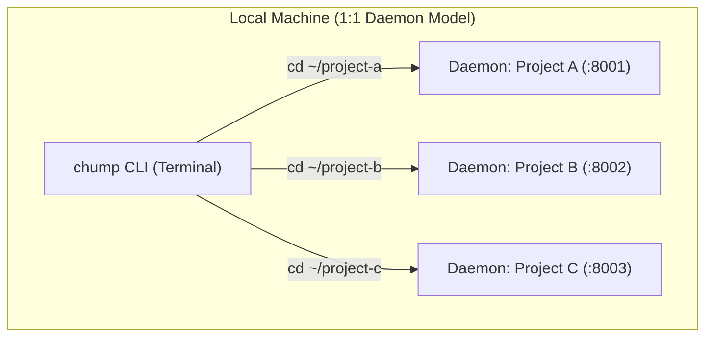
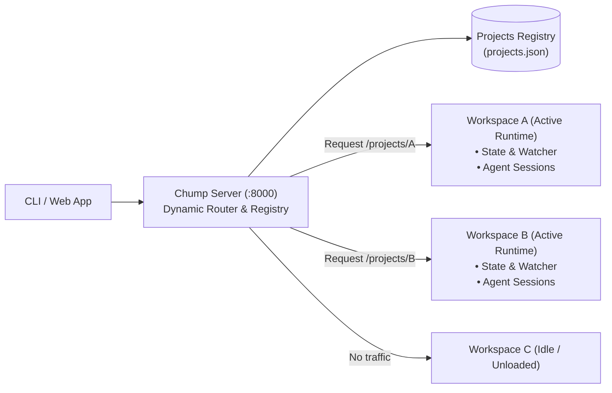

Chump is an AI coding agent harness built on `ai-query`. I started it as a plain client/server split. A Python backend, `chump-server`, ran the agent loops, tool execution and file watchers. A TypeScript frontend gave you the CLI and the web interface.

The server model was simple: **one workspace, one background daemon.**

Run `chump` in a project directory and the CLI quietly forked a Python process bound to that path. The daemon grabbed a free local port, started file watchers, and managed every agent session for that one codebase.



For tinkering in one directory on your laptop, this was fine. Then we wanted remote execution and a collaborative web app, and the model fell apart.

### Remote multi-tenancy

On a remote VPS or dev server you can't SSH in, fork a Python process and hunt for a free port every time someone opens a repo. Keep the model anyway and you end up writing a process manager.

1. **Ports and firewalls.** Every workspace needs another port opened, tracked and reverse-proxied.
2. **Wasted memory.** Twenty idle projects means twenty Python baselines, twenty sets of imports, and zombie processes nobody owns.
3. **Scattered state.** Nothing can tell you which workspaces exist, which sessions are active, or where errors are happening.

We didn't need twenty daemons. We needed **one control plane**.

### In-process workspace runtimes

We gutted the per-workspace daemon and rebuilt `chump-server` as one multi-project control plane.

A single `uv run chump-server` listens on `:8000`, routes by project, and mounts project runtimes lazily, in-process, as `asyncio` task trees.



#### 1. Static routes, dynamic dispatch

We don't start servers on demand. The project-scoped routes are mounted once at startup, and the project comes from the URL path:

```python
# chump_server/main.py
def on_app_setup(self, app: web.Application) -> None:
    # Global control plane & project registry
    app.router.add_get("/projects", self.list_projects)
    app.router.add_post("/projects", self.register_project)
    app.router.add_delete("/projects/{project_id}", self.unregister_project)

    # Project-scoped runtime endpoints
    app.router.add_get("/projects/{project_id}/health", self.project_health)
    app.router.add_get("/projects/{project_id}/sessions", self.project_sessions)
    app.router.add_post("/projects/{project_id}/sessions", self.create_session)
    app.router.add_get("/projects/{project_id}/files", self.project_files)
    app.router.add_get("/projects/{project_id}/events", self.project_ws_events)
    app.router.add_post("/projects/{project_id}/terminal", self.project_terminal)
```

#### 2. Lazy in-memory hydration

A request to `/projects/{project_id}/...` makes the control plane check a dictionary in memory:

```python
# chump_server/runtime_manager.py
class RuntimeManager:
    def __init__(self, registry: ProjectRegistry):
        self.registry = registry
        self._active_runtimes: dict[str, WorkspaceRuntime] = {}

    async def get_or_create(self, project_id: str) -> WorkspaceRuntime:
        if project_id in self._active_runtimes:
            return self._active_runtimes[project_id]

        project_meta = await self.registry.get(project_id)
        if not project_meta:
            raise web.HTTPNotFound(text=f"Project {project_id} not registered")

        # Spin up asyncio tasks, file watchers, and session state in-process
        runtime = await WorkspaceRuntime.boot(path=project_meta.path)
        self._active_runtimes[project_id] = runtime
        return runtime
```

No forks. No port allocation. With 50 projects registered, the idle ones cost an entry in `projects.json`.

### Before and after

| Metric / Behavior | Per-Workspace Daemons (Before) | Unified Control Plane (After) |
| :--- | :--- | :--- |
| **Port Management** | 1 port per active project (`:8001`, `:8002`, ...) | Single fixed port (`:8000`) |
| **Process Overhead** | ~45 MB baseline Python heap *per workspace* | 1 shared Python process (~60 MB total idle) |
| **Project Discovery** | None (client had to guess or store ports) | Central `/projects` registry API |
| **Remote Deployment** | Complex (dynamic reverse proxy / ssh tunneling) | Simple (single reverse proxy / VPN tunnel) |
| **Lifecycle** | Orphaned daemons lingered after CLI exited | Controlled graceful shutdown & timeout idle evictions |

### What it costs

One process for everything fixed the bottlenecks. It also brought problems we have to handle on purpose.

#### 1. Auth and blast radius

Standalone `uv run chump-server` has no authentication by default. The bearer-token layer is only added when it runs as a managed local service.

> **warning:** if you expose `chump-server` on `0.0.0.0` to the public internet without a reverse proxy (Cloudflare Access, Tailscale) or token auth, you've exposed arbitrary file read/write and terminal execution across every registered project.

#### 2. Client migration

The TypeScript frontend has to talk to both old direct servers and the new control plane, so it needs an explicit target type:

```typescript
// client/src/api/target.ts
export type ApiTarget =
  | { kind: 'direct'; baseUrl: string }
  | { kind: 'control-plane'; baseUrl: string; projectId: string };

export function buildProjectUrl(config: ChumpConfig, path: string): string {
  // Legacy fallback: single-workspace direct server
  if (config.apiTarget.kind === 'direct') {
    return `${config.apiTarget.baseUrl}${path}`;
  }
  // Modern multi-project control plane
  const { baseUrl, projectId } = config.apiTarget;
  return `${baseUrl}/projects/${encodeURIComponent(projectId)}${path}`;
}
```

### Takeaway

Building an agent harness pulls your attention to prompts, tools and models. Once you leave the local prototype and share the thing, the hard problems are old systems problems:

- Process isolation against memory use
- One port per thing against one router
- Cleaning up what's idle

Killing the per-workspace daemon wasn't AI research. It was plumbing. It made the whole system sturdier.
