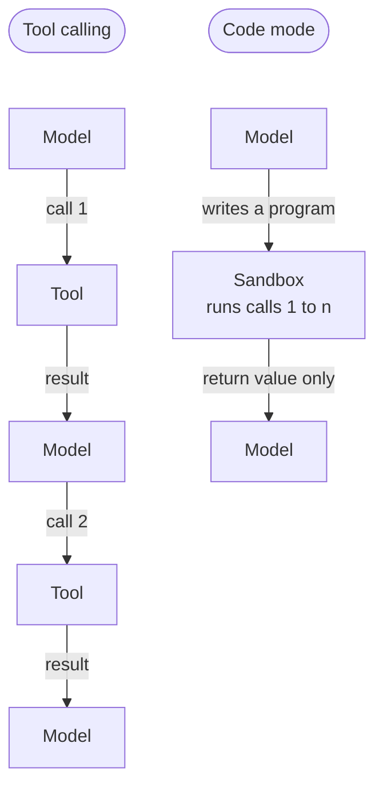
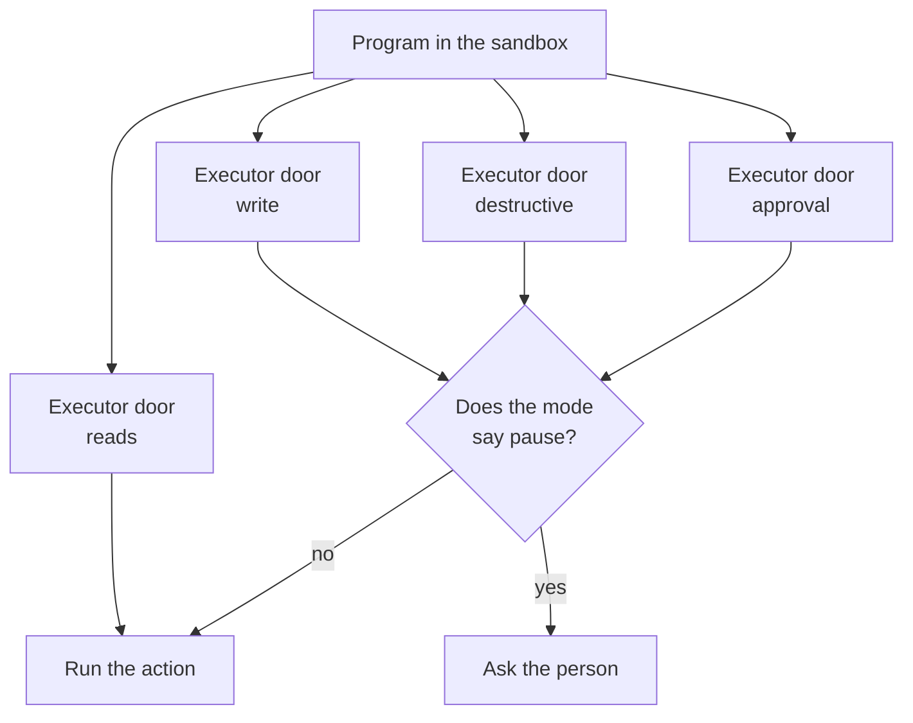
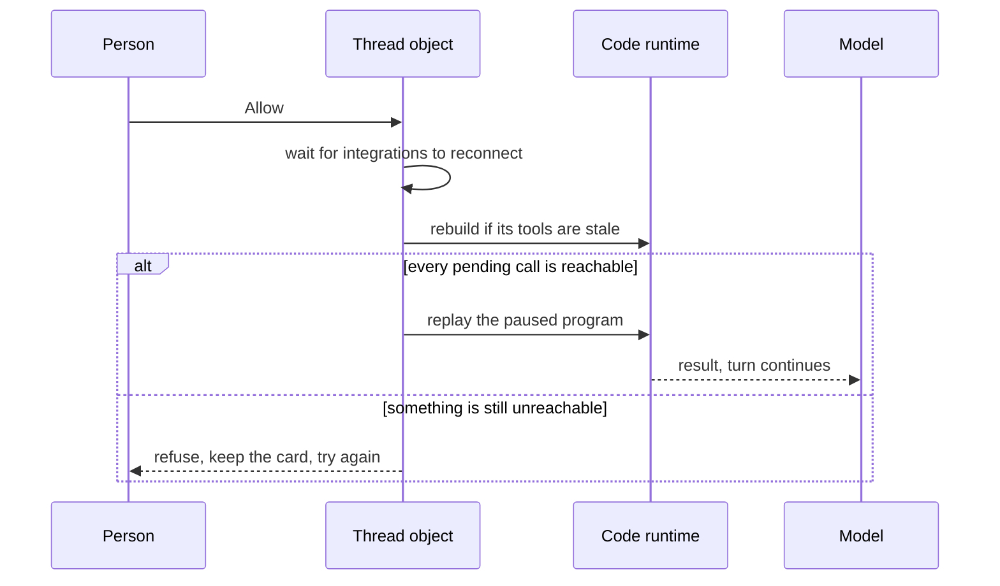
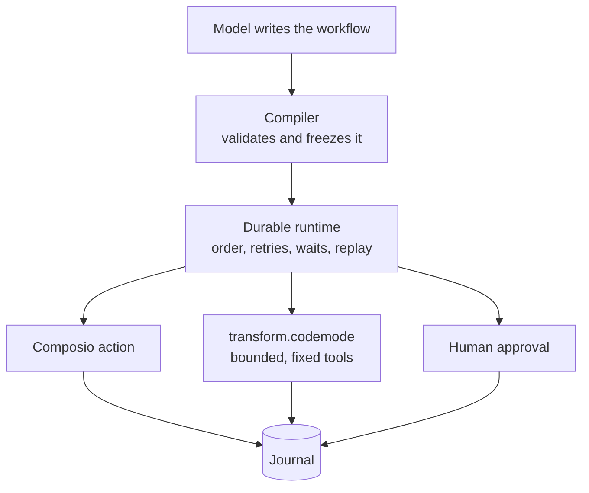

Most of what's written about code mode is about what it gives you. Fewer round trips. Less in the context window. A program you can keep instead of a transcript. All true, and I'd build it again.

But I've now built on code mode in two projects, [AgentSpec](/blog/why-ai-authored-workflows-became-a-compiler-problem) and [Thirdpen](/blog/we-are-launching-thirdpen-v2), and what I mostly learned was what it takes away.

The idea first. Instead of calling tools one at a time, the model writes a small program that calls them. The program runs in a sandbox. Each tool result lands in a variable instead of the conversation, and only what the program returns goes back to the model.

_Tool calling pushes every result through the model. Code mode keeps them in the program._

Here is what it takes away. In a tool-calling loop, control returns to the harness after every call. That sounds like overhead, and it is. But it is also a checkpoint. At each one, the harness can look at what the model wants to do, show it to a person, refuse it, log it, or stop. You never had to build those places. They were just the gaps between the model's turns.

Code mode closes the gaps. One turn, many calls, and the harness gets control back only when the program ends. Everything you used to do in the gaps has to move somewhere else.

Here is where I put it.

## Approval

Thirdpen's agent works on real accounts: Gmail, Slack, Drive. The rule I wanted is the one you'd give a new hire. Reading is fine. Sending asks first.

With tool calling that's easy, because you see each call before it runs. In code mode you can't. The runtime decides whether to pause before the program starts, and it decides per method. It never sees the arguments, because the arguments don't exist yet. Code that hasn't run is going to compute them.

This didn't matter until I connected Composio, which puts every action in every connected app behind one method. The real work is a list of action names inside the arguments. That method is marked destructive, because it can be. So pausing on the method made reading an inbox wait for a click.

The fix was to register the same executor four times: one for reads, one for writes, one for destructive actions, and a door the agent walks through when it wants a person to look. Each one refuses any action riskier than itself, with an error that names the method to use instead. Reads keep the original name, because Composio's own instructions tell the model to call it. So reads pass first try, and a write costs one retry.

_Four doors to one executor. Each pauses, or doesn't, according to the person's permission mode._

The method name is the permission. It's the only thing the runtime can see before the code runs, so that's where the rule has to live.

Two details I'm glad I kept. An action nobody has classified counts as a write, so the worst case is an extra prompt, never an unguarded call. And the fourth door isn't a risk level at all. Composio tags a sent email and a saved draft the same way, so no classifier can tell them apart. The agent is told to use that door before it sends, posts, shares, pays or deletes. That one is a convention, not enforcement. An agent that forgets, or is tricked, can still use the ordinary write door. I'd rather say that plainly than pretend otherwise.

## Pausing

What does the model see when a run pauses for approval?

By default, `{ status: "paused" }`, as if it were any other tool result. I had a description telling it not to re-issue the code. It re-issued the code anyway, often enough to matter. Each re-issue was a new execution with its own approval card, and approving both ran the side effect twice.

In tool calling a pause is the end of a step. In code mode it's a half-finished program, and a model that has been told to be thorough treats it like an error to retry.

So I stopped asking. Now the turn ends the moment a run pauses. The card is what the person sees, and the agent carries on by itself when a decision comes in, so the model loses nothing by stopping.

If you don't want the model to do something, don't write it a rule. Make the harness unable to let it.

## Resuming

The decision comes from a button, not from a turn. It arrives over RPC, outside any conversation, and sometimes after the object that holds the thread was evicted while the person read the card.

The runtime that replays the paused program then gets built cold, before the integrations have reconnected, so it has no tools. The replay reaches the approved call and fails: tool not found. The model reads the error, re-issues the code, and pauses again. The person sees Allow do nothing. The same card comes back.

The fix is ordered. Wait for the integrations to settle. Rebuild the runtime if its tools are stale, or if it was built for someone else, since a collaborator can approve a run the creator started. If a call is still out of reach, refuse the decision and keep the card, rather than run into the failure.

_A paused program is state. The tools it was built with are part of that state._

## Where code mode doesn't belong

AgentSpec taught me the opposite lesson. The first version let the model run the workflow. It chose what ran next, carried the state, and decided when the work was done. We replaced that with a compiler, a durable runtime and a journal, so the model stopped being the engine.

Code mode would have been a way back in: a model-written program deciding control flow, in the one place we had just taken that away. So the design doc is blunt. Code mode must not choose workflow transitions, replace the compiled form, own replay, or own durable waits.

It can appear as one bounded node. The compiled workflow has a `transform.codemode` node that names which tool surface it may touch, and every input, output and side effect of it goes in the journal.

_Code mode inside a box. The durable runtime stays in charge._

A code-mode program lives for one turn. A workflow has to live for days. One is disposable and the other has to be replayable, so keep the disposable one inside a box in the durable one.

## Smaller scars

**Keep what comes back small.** Values returned from the program stay under 1 MB. No screenshots, blobs or bulk page content come back through it. Large files move by reference: a separate tool builds big bundles straight from workspace files, so the bytes never pass through the program.

**Only hand the sandbox tools it can call.** Some tools are answered by the browser, like a question card asking the person something. Code in the sandbox can't reach them, and handing them over only fills the logs with warnings until one that matters scrolls past. I filter by whether a tool can run on the server, not by name.

**Keep what is meant to be seen outside.** A view shown from inside the program would land in that call's output and never be drawn. So views are a direct tool, not part of the set the sandbox gets.

**Code mode is not a computer.** Thirdpen has three ways to execute: code mode for short passes that compose approved tools, a browser, and a Linux sandbox for work that needs a real operating system. The Linux sandbox is disposable and owns no durable state. Code mode is for composing tools, not for installing packages.

**Runtimes for this are young.** AgentSpec's design puts its own adapter in front of SecureExec's code mode, so the runtime can be replaced without changing what the product promises.

## What I'd tell myself

A tool-calling loop is slow, and the slowness was doing a job. Every call was a place where someone could look.

Code mode takes away the slowness, and the places to look go with it. Usually that's a good trade. But you have to notice it's happening. Decide which of those places you still need, and put them where the runtime can find them.

Before a program runs, the only thing the host can see is the shape of its tools: their names, their levels, the walls of the sandbox. So that's where the rules live. Not in the prompt, and not in the arguments.
